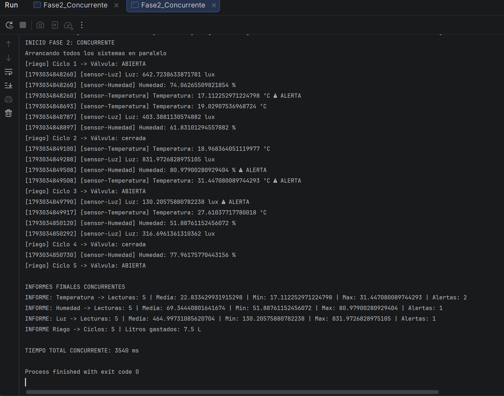

# Invernadero con hilos

## Qué hace

En esta práctica trabajo con un invernadero simulado. Tengo tres sensores que generan lecturas de temperatura, humedad y luz, y un programador que alterna la apertura y el cierre de una válvula de riego. No hay dispositivos físicos conectados: los sensores generan números aleatorios y las esperas representan el tiempo que necesita cada dispositivo para volver a actuar.

Mi objetivo es comparar dos maneras de hacer el mismo trabajo. En la primera, ejecuto todos los dispositivos uno detrás de otro. En la segunda, doy un hilo a cada uno para que sus esperas se solapen. Después hago tres experimentos para entender `join()`, la diferencia entre `run()` y `start()`, y lo que ocurre al intentar arrancar dos veces un mismo hilo. Por último, añado un vigilante que consulta los estados de los cuatro dispositivos.

Cada sensor toma cinco lecturas y tiene su propio periodo y rango:

- Temperatura: cada 400 ms, genera valores desde 15,0 hasta menos de 35,0 ºC. El rango correcto va de 18 a 30 ºC.
- Humedad: cada 600 ms, genera valores desde 40,0 hasta menos de 90,0 %. El rango correcto va de 50 a 80 %.
- Luz: cada 500 ms, genera valores desde 0,0 hasta menos de 1000,0 lux. El rango correcto va de 200 a 900 lux.
- Riego: hace cinco ciclos, alternando la válvula abierta y cerrada, con una espera de 700 ms después de cada ciclo.

`ThreadLocalRandom.current().nextDouble(min, max)` incluye el límite inferior y excluye el superior. Uso la misma operación que propone el enunciado. Los límites del rango correcto sí se aceptan: la alerta aparece solo si el valor es menor que el mínimo o mayor que el máximo.

El código está organizado en estas clases:

- `Sensor.java` define la tarea común, las cinco lecturas, las alertas, las estadísticas y el informe. Es abstracta e implementa `Runnable`.
- `Temperatura.java`, `Humedad.java` y `Luz.java` heredan de `Sensor`, configuran sus periodos, unidades y umbrales e implementan `medir()`.
- `ProgramadorRiego.java` es el hilo del riego y guarda sus ciclos y sus litros.
- `Fase1_Secuencial.java` ejecuta los cuatro dispositivos mediante llamadas directas a `run()`.
- `Fase2_Concurrente.java` arranca los cuatro hilos, espera a todos y muestra los informes y el tiempo.
- `Fase3_Experimentos.java` ejecuta los experimentos A, B y C en ese orden.
- `Fase4_Vigilante.java` añade el hilo demonio que consulta los estados cada 300 ms aproximadamente.

Los ejemplos de los cohetes y los cocineros me sirven como referencia para las dos formas de trabajar. El sensor sigue la idea del cocinero: es una tarea y necesita un `Thread`. El riego sigue la idea del cohete: el propio objeto hereda de `Thread`.

En `Sensor.run()` obtengo una lectura llamando a `medir()`. La primera lectura establece tanto el mínimo como el máximo. A partir de la segunda comparo cada valor con esos extremos. También incremento el número de lecturas, sumo el valor y compruebo si debe contar como alerta.

Cada objeto conserva sus propios contadores. La temperatura no comparte sus estadísticas con la humedad ni con la luz. La constante de cinco lecturas es común, pero el número realizado, la suma, los extremos y las alertas pertenecen a cada instancia.

El informe devuelve el nombre, las lecturas realizadas, la media, el mínimo, el máximo y las alertas. La media se calcula dividiendo la suma entre las lecturas realizadas. Si todavía no hay lecturas, devuelve 0,0 para evitar una división entre cero. En ese caso los ceros del informe significan que aún no hay datos. No representan una medición real de cero.

El log de los sensores incluye un tiempo en milisegundos obtenido con `System.currentTimeMillis()`, el nombre del hilo que ejecuta la tarea, el nombre del sensor, el valor y su unidad. Si la lectura sale del rango correcto, añade `⚠ ALERTA`. Después de cada lectura se ejecuta `Thread.sleep(periodoMs)`, incluida la quinta lectura.

El riego sigue esta secuencia: abierta, cerrada, abierta, cerrada y abierta. Cada apertura añade 2,5 litros, así que al terminar los cinco ciclos el total es de 7,5 litros.

`CICLOS_TOTALES`, `PERIODO_MS` y `LITROS_POR_APERTURA` son constantes y por eso sus nombres están en mayúsculas. `ciclosTotales` es una variable de cada objeto que empieza con el valor de `CICLOS_TOTALES`. En los experimentos puedo ponerla a tres o a uno sin cambiar la constante de cinco.

Los cinco ciclos no equivalen a cinco aperturas. Solo abro tres veces, por eso el informe normal termina con cinco ciclos y 7,5 litros. La variable booleana se invierte después de imprimir cada ciclo y prepara el estado del siguiente. No representa una orden real enviada a una válvula física.

## Cómo ejecutarlo

Uso JDK 21 y ejecuto el método `main` de la fase que quiero comprobar. En IntelliJ, pulso el botón de ejecutar junto al método y selecciono la opción para ejecutar esa clase.

- `Fase1_Secuencial`: ejecución de los dispositivos uno detrás de otro.
- `Fase2_Concurrente`: ejecución de los cuatro hilos con sus informes finales.
- `Fase3_Experimentos`: experimentos A, B y C.
- `Fase4_Vigilante`: consulta de estados con el vigilante demonio.

Las mediciones registradas se han realizado con Microsoft OpenJDK 21.0.12.1. La compilación y las ejecuciones están comprobadas por terminal. La fase 2 también se ha ejecutado desde IntelliJ, como se ve en la captura.

## Captura

Esta es una ejecución de `Fase2_Concurrente` en la consola de IntelliJ. Se ven las lecturas intercaladas, los informes de los tres sensores con cinco lecturas, los cinco ciclos de riego y los 7,5 litros. En esta ejecución el tiempo total fue de 3.540 ms y el programa terminó con código de salida 0.

## Resultados

Las siguientes cifras proceden de tres ejecuciones por fase realizadas el 26 de octubre de 2026, con Windows y Microsoft OpenJDK 21.0.12.1. Se ejecutaron las fases en procesos separados, sin cambiar los periodos ni el número normal de lecturas o ciclos. 

| Ejecución | Fase 1: secuencial | Fase 2: concurrente |
|---:|---:|---:|
| 1 | [11.166 ms](docs/resultados/Fase1_Secuencial-1.txt) | [3.566 ms](docs/resultados/Fase2_Concurrente-1.txt) |
| 2 | [11.164 ms](docs/resultados/Fase1_Secuencial-2.txt) | [3.535 ms](docs/resultados/Fase2_Concurrente-2.txt) |
| 3 | [11.191 ms](docs/resultados/Fase1_Secuencial-3.txt) | [3.566 ms](docs/resultados/Fase2_Concurrente-3.txt) |
| Media | 11.173,67 ms | 3.555,67 ms |

La tabla usa el tiempo que imprime cada programa con `System.currentTimeMillis()`, no el tiempo completo de arranque y cierre de la JVM. En ambas fases la medición empieza antes de ejecutar o arrancar los dispositivos y termina antes de imprimir los informes finales. En la fase concurrente termina después de los cuatro `join()`.

En las seis ejecuciones, los tres sensores terminaron con cinco lecturas y el riego con cinco ciclos y 7,5 litros. Las lecturas concretas y el número de alertas cambian porque los valores son aleatorios. Las salidas completas están en [docs/resultados](docs/resultados). En [resultados.json](docs/resultados/resultados.json) también se conserva la duración externa de cada proceso, separada del tiempo interno que usa esta tabla.

Con los periodos del código, las cinco esperas de temperatura suman 2.000 ms, las de humedad 3.000 ms, las de luz 2.500 ms y las del riego 3.500 ms.

En la fase secuencial sumo las cuatro duraciones: `2000 + 3000 + 2500 + 3500 = 11000 ms`. En la concurrente las esperas se solapan, así que la referencia es la duración más larga: `max(2000, 3000, 2500, 3500) = 3500 ms`, correspondiente al riego.

El cálculo cuenta cinco esperas por dispositivo porque el código también duerme después de la última acción. No estoy contando solo los cuatro intervalos entre cinco lecturas.

Las medias medidas están cerca de esos valores: unos 11,17 segundos frente a unos 3,56 segundos. La relación entre ambas medias es aproximadamente 3,14. Eso supone una reducción del tiempo cercana al 68 %. No espero cuatro veces menos tiempo, porque las cuatro tareas tienen duraciones distintas y el riego marca el final de la versión concurrente.

Hay una pequeña diferencia respecto al cálculo por las impresiones, el arranque de los hilos y la planificación del sistema. `sleep()` tampoco garantiza reanudar el hilo exactamente en el milisegundo solicitado. Estos resultados describen este entorno. No son una promesa de obtener siempre el mismo número.

## Análisis

### ¿Por qué compensa usar hilos en el invernadero?

En mi versión secuencial, cuando el sensor de humedad está esperando, el resto de dispositivos no avanza. Todo ocurre en el hilo `main`. Con la versión concurrente, mientras un dispositivo duerme, los demás pueden continuar. Cada sensor tiene su tarea, su hilo y sus propios datos, y el riego funciona en su propio hilo.

Arranco primero los cuatro hilos y después hago los cuatro `join()`. Esperarlos uno detrás de otro no convierte el trabajo en secuencial: todos ya están arrancados cuando empiezo a esperar. Si arrancara un hilo y lo esperara antes de arrancar el siguiente, perdería el solapamiento que quiero conseguir.

El orden del log no es una secuencia acordada por mi código. El planificador decide cuándo progresa cada hilo y puede cambiar el orden entre ejecuciones. Una salida intercalada ayuda a verlo, pero la prueba más clara combina el código de arranque, la espera a todos y los tiempos medidos. Que dos ejecuciones coincidan en algunas líneas no demostraría que no exista concurrencia.

Los hilos tienen sentido aquí porque hay esperas largas y tareas independientes. No puedo trasladar esta mejora a cualquier programa: crear hilos también tiene coste, y una tarea pequeña o limitada por cálculo necesita otro análisis. Tampoco confundo concurrencia con la garantía de que cuatro instrucciones estén ejecutándose físicamente a la vez.

### Experimento A: consultar el informe sin esperar

Creo un objeto `Luz`, lo paso a `new Thread(sensorA, "hilo-ExpA")`, lo arranco y consulto inmediatamente `sensorA.informe()`. Después hago `hiloA.join()` y vuelvo a consultar el mismo objeto.

En las tres ejecuciones registradas, el primer informe mostraba cero lecturas. Después de `join()`, el mismo sensor mostraba las cinco lecturas completas.

No puedo concluir que el primer informe siempre vaya a salir vacío. `start()` no espera a que se hayan completado las cinco lecturas. El sensor puede haber avanzado cuando `main` consulta sus campos. Además, esa consulta temprana lee estadísticas que otro hilo está modificando sin coordinar esa lectura. Ni siquiera tengo garantizada una fotografía coherente de todos los campos.

Hay un detalle visible en la primera ejecución: puede aparecer una lectura en consola antes que la línea que muestra un informe con cero lecturas. No es una contradicción. El texto del informe se calcula antes de imprimirlo y los dos hilos pueden alternarse entre esas operaciones. El orden de las líneas no convierte esa consulta anticipada en una consulta segura.

Después de un `join()` que termina normalmente, la tarea ya ha acabado y el informe contiene las cinco lecturas. Por eso uso `join()` para decidir cuándo mostrar los informes definitivos de la fase concurrente.

### Experimento B: llamar a `run()` directamente

Creo un riego nuevo, pongo `ciclosTotales = 3` y llamo a `riegoB.run()`. Los tiempos medidos registrados fueron 2.146, 2.162 y 2.145 ms, próximos a `3 × 700 = 2100 ms`. El objeto termina con estado `NEW` en las tres ejecuciones.

La llamada directa a `run()` es una llamada de método que ejecuta `main`. No arranca el hilo representado por el objeto. Por eso el objeto continúa en `NEW`, aunque el código del riego ya haya realizado tres ciclos. Las dos aperturas de esos tres ciclos equivalen a 5 litros, aunque este experimento no imprime el informe del riego.

El log muestra `[main]`. Dentro de `ProgramadorRiego.run()` uso `Thread.currentThread().getName()` para identificar al hilo que está ejecutando el ciclo. El objeto conserva el nombre `riego`, pero en esta llamada directa el trabajo lo realiza `main`.

En la fase secuencial, tanto los sensores como el riego muestran `main` porque todo se ejecuta con llamadas directas a `run()`. En la fase concurrente, el riego muestra `[riego]` porque allí sí arranco ese hilo con `start()`.

Si usara `start()` sobre ese objeto nuevo, arrancaría su hilo y necesitaría `join()` para medir hasta su finalización. El tiempo de los tres ciclos seguiría rondando 2,1 segundos. Lo que cambia es quién realiza el trabajo y si `main` puede seguir avanzando mientras tanto.

### Experimento C: arrancar dos veces el mismo hilo

Creo otro riego, lo configuro con un ciclo, llamo a `start()` y espero con `join()`. Después de esa espera aparece `TERMINATED`. Cuando intento llamar otra vez a `start()` sobre el mismo objeto, se captura `IllegalThreadStateException` en las tres ejecuciones registradas.

Un objeto `Thread` solo se puede arrancar una vez. Que haya terminado no lo deja preparado para empezar de nuevo. Si quiero otro trabajo de riego, tengo que crear otro objeto. La restricción también impide arrancarlo de nuevo mientras sigue activo.

Capturo específicamente `IllegalThreadStateException`, muestro su nombre y explico en consola que el mismo hilo no se puede arrancar dos veces y que para volver a regar hace falta otro `ProgramadorRiego`. No dependo de que la excepción incluya un mensaje propio.

### Estados observados

El vigilante es un quinto hilo de trabajo, además de `main`: observa los tres sensores y el riego. Su bucle consulta los cuatro estados y después duerme 300 ms. Por eso el intervalo real entre dos bloques puede ser algo mayor que 300 ms: también hay que contar lo que tarda en consultar e imprimir.

En las tres ejecuciones registradas de la fase 4 aparecieron `NEW`, `TIMED_WAITING` y `TERMINATED`. No se capturaron `RUNNABLE`, `WAITING` ni `BLOCKED`. Esto describe las salidas conservadas, no todos los estados que un hilo podría atravesar entre consultas.

| Estado | Cuándo puede producirse en este proyecto | Línea u operación relacionada |
|---|---|---|
| `NEW` | He creado el objeto `Thread`, pero todavía no he llamado a `start()`. | Creación de los hilos. Consultas de `Fase4_Vigilante.java`, líneas 53–56. En el experimento B el riego sigue aquí tras la llamada directa a `run()`. |
| `RUNNABLE` | El hilo ha arrancado y puede ejecutar instrucciones. No significa necesariamente que esté usando un núcleo justo en ese instante. | `start()` en líneas 59–62 y código de los métodos `run()` entre esperas. El muestreo puede no capturarlo. |
| `TIMED_WAITING` | Un dispositivo está esperando su periodo. | `Thread.sleep(periodoMs)` en `Sensor.java:100` o `Thread.sleep(PERIODO_MS)` en `ProgramadorRiego.java:60`. |
| `TERMINATED` | El `run()` del hilo arrancado ha terminado. | Salida de los bucles. Consultas después de los `join()` en líneas 79–82. `join()` espera la terminación, no la provoca. |
| `WAITING` | Lo espero en `main` cuando un `join()` sin límite está esperando a un hilo todavía vivo. | `Fase4_Vigilante.java`, líneas 66–69. El vigilante actual no consulta el estado de `main`. |
| `BLOCKED` | Según la tabla del CheatSheet, corresponde a esperar para entrar en un `synchronized` ocupado. | No hay un bloqueo explícito de aplicación diseñado para producirlo. No debo confundirlo con `sleep()` ni con la espera de `join()`. |

La tabla distingue lo que significa cada estado de lo que se ha llegado a observar. Un muestreo cada 300 ms no registra necesariamente las transiciones breves. Tampoco obtiene una fotografía simultánea de los cuatro hilos: las consultas se hacen una tras otra.

El bloque periódico del vigilante consulta los cuatro dispositivos. También muestro temperatura, humedad, luz y riego antes de sus `start()` y después de los cuatro `join()`. Así puedo comprobar los cuatro objetos en los momentos inicial y final, sin depender de que el vigilante los capture justo entonces.

¿Por qué termina el programa si el vigilante sigue en su bucle?

Antes de arrancarlo llamo a `hiloVigilante.setDaemon(true)`. Los cuatro dispositivos y `main` son los hilos normales que mantienen viva esta ejecución. Cuando terminan los dispositivos, sus `join()` permiten que `main` continúe y termine también. Si solo queda el vigilante demonio, este no impide el cierre de la JVM.

No hay una condición oculta que ponga su `while (true)` a falso. El cierre puede cortar al demonio sin una última impresión ni una despedida. Por eso no usaría este comportamiento para una tarea que tenga que guardar datos o cerrar una válvula física antes de salir.

En las fases 2, 3 y 4, si un `join()` lanza `InterruptedException`, muestro el aviso y salgo de `main` con `return`. Así no presento como definitivo un informe que todavía podría estar incompleto ni unos estados finales que aún no he comprobado. Este `return` sigue la forma de salir que usa el ejemplo de Cocina cuando se interrumpe su espera.

Salir de `main` no cancela los trabajadores que ya están arrancados. Estos pueden seguir hasta acabar sus lecturas o ciclos. En las pruebas de interrupción de las fases 2, 3 y 4 se comprobó que no se publicaban informes definitivos ni estados finales después del aviso.

### Thread frente a Runnable

| Aspecto | `Thread` | `Runnable` | Cómo lo veo en mi práctica |
|---|---|---|---|
| Qué representa | Un objeto que representa un hilo. | Una tarea que puede ejecutar un hilo. | El riego es un `Thread`. Cada sensor es una tarea. |
| Cómo lo arranco | Llamo a `start()` sobre el hilo. | Creo un `Thread` con la tarea y arranco ese hilo. | `hiloRiego.start()` frente a `new Thread(tareaTemp, "sensor-Temperatura")`. |
| Dónde escribo el trabajo | En mi sobrescritura de `run()`. | En la implementación de `run()`. | El trabajo común de los sensores está en `Sensor.run()`. |
| Nombre del ejecutor | Puedo consultar el nombre del objeto con `getName()`, pero para identificar al ejecutor real uso `Thread.currentThread().getName()`. | Consulto `Thread.currentThread().getName()`. | En el experimento B aparece `main` y en la fase 2 aparece `riego`. |
| Herencia | Heredar de `Thread` ocupa la única superclase que puedo extender. | Implementar una interfaz permite conservar otra superclase. | Los sensores concretos ya heredan de `Sensor`. |
| Reutilización | No puedo volver a llamar a `start()` sobre el mismo hilo. | Puedo pasar una tarea a otro hilo, si su estado permite reutilizarla. | Mis sensores acumulan estadísticas: para una ejecución limpia creo objetos nuevos. |
| Estadísticas | No las calcula automáticamente. | Tampoco las calcula automáticamente. | Las programo en `Sensor` y en el riego y las leo al terminar. |

¿Por qué los sensores solo pueden ser Runnable en mi diseño?

`Temperatura`, `Humedad` y `Luz` ya extienden `Sensor`, que reúne lo que tienen en común. Java no permite que una clase extienda simultáneamente `Sensor` y `Thread`. Mantengo esa herencia y hago que `Sensor` implemente `Runnable`. Así las tres clases son tareas sin duplicar el bucle y las estadísticas.

La limitación se refiere al diseño que pide la práctica. No significa que Java prohíba que un sensor sea un hilo en cualquier diseño: podría cambiar la jerarquía y hacer que `Sensor` heredase de `Thread`, pero entonces ya no estaría utilizando el modelo de tareas que se solicita aquí.

¿Qué forma elegiría para el riego y por qué?

En esta práctica mantengo `extends Thread` porque el enunciado pide usar las dos formas y quiero ver la diferencia con los sensores. El constructor `super("riego")` deja el nombre del hilo fijado desde el principio y puedo arrancarlo directamente.

Si diseñara el sistema sin esa condición, elegiría una tarea `Runnable` para separar el trabajo de regar del hilo que lo ejecuta. Así podría mantener otra superclase si la necesitara y controlar el hilo desde fuera. Eso no hace que una tarea con contadores sea reutilizable sin más: seguiría teniendo que decidir cómo inicializo o reinicio sus datos.

## Referencias

Para el modelo y los métodos de hilos utilizo los materiales de clase del Tema 4: el enunciado de Invernadero con hilos, los ejemplos de Cohetes y Cocina, el CheatSheet y la presentación de multihilo.

Los sensores siguen el patrón `Runnable` de Cocina. El riego utiliza la herencia de `Thread` de Cohetes, y las consultas de estados, las esperas y el demonio siguen los métodos del CheatSheet y las fases del enunciado.
